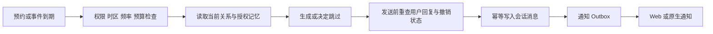

# 网站：AI 陪伴与角色社区重构提案

状态：早期调研与过程记录；最新确定的产品边界、分批交付和验收以[执行计划](companion-platform-final-plan.md)为准。develop 正在分批开发；现行架构、计费与发布规范仍然有效。
调研日期：2026-09-28（America/Chicago）。依据：本地 dev 代码、仓库文档和公开一手资料；没有登录竞品付费账户、验证生产数据或执行真实支付。

当前确定的内容模型：**公开角色和公开场景同属 Prompt 卡，但角色能建立独立关系与记忆，场景只定义环境规则**。两者共用 Market 的 `scenario` 存储和发布／版本／发现，以不可变 `content.kind` 区分。旧结构化卡推断为角色，旧 prompt-only 卡推断为场景。`multi-scene` 退出 Market，真人群聊保留；波形仍属设备内容。下文早期多人场景和“场景可直接开始角色聊天”的文字是规划过程记录，以[角色卡与在线编辑器设计](character-editor-design.md)和第 23 节为准。

## 1. 产品方向与范围

用户已明确：**先规划网站；泛 AI 陪伴用户优先，角色与社区为主；设备仍是重要一环，原有设备结构与连接不改动；聊天记录全部经过服务器，不再持久化于本地。**

本提案聚焦网站及必要服务端改造。跨端由账户与服务端数据模型支撑；Android/桌面原生端只列兼容约束，不列入本轮界面重构交付。下文“手机”指手机浏览器。

**最终范围：前述功能全部纳入，允许分批，不允许借“最小改造”删掉需求。尽可能少改指复用现有结构、Market、设备连接与服务；第 1 节描述第一批切入点，第 15 节完整需求追踪表和四批交付计划是总体范围依据。**

### 最小升级范围：先复用，再补缺口

1. 网站首页改为聊天入口与统一会话列表；先把现有 Agent、私聊与房间以适配器装配进同一个外壳，不立刻重写所有消息组件或搬迁房间后端。
2. Market 保持现有路由与发布、搜索、所有权、审核机制。增加“角色”内容类型和角色详情/开始聊天；现有场景和波形原样保留。首页的“发现角色”直接进入 Market，不再建设另一个独立社区系统。
3. 在已有场景数据之上增加兼容的角色元数据与关系记录，保留 prompt 全文与旧场景编辑。先补姓名、头像、简介、开场、语气、示例与长期称呼，不先上复杂世界观编辑器。
4. 服务器聊天是必要的实质性改造：复用 Auth、D1、Chat 和模型网关；新增消息级存储及必要接口，替换网站聊天的本地持久化 owner。不能用“仍存在 IndexedDB，只多上传一份”代替用户要求。
5. 第一版记忆先做可编辑的用户事实、共同约定、关系记录和会话摘要；在此基础上支持用户设定时间的主动聊天。向量图谱、自动生活叙事、复杂柔性触达后续再做。
6. 保留已有 Credit、余额和消费账本，先让聊天区看见余额、用量、充值状态与订单处理状态；沿既有预留/结算补正式支付，首批不引入订阅或多钱包。创作者奖励只发站内 Credit，整个路线均不支持提现。
7. Voice 从聊天中打开已有通话能力，关联同一角色和会话；摄像头、Control 与设备结构不重做。先继续使用现有真人私聊与房间，长期群作为独立增量，不直接改掉房间回收语义。

首轮暂不做：独立 Discover 后端、新推荐模型、AR/avatar、视频生成、开放工具市场、图数据库、复杂订阅、原生端改版。情境图片可作为首轮后的第一个媒体扩展。

可先按三个可验收增量排期：A 聊天首页 + Market 角色入口 + 长期称呼；B 服务器历史 + 旧记录迁移 + 基础记忆；C 定时主动聊天 + 语音连续 + 正式支付闭环。A 可以先做原型，但正式发布不得越过 B 的数据门槛；每个增量再根据测试和人员情况估时，不把完整愿景的粗估当作首轮承诺。

产品定位：一个以聊天为中心的平台，让用户与有独立设定、能记住共同经历、能够主动联系并协助完成任务的 AI 角色建立持续关系，也能与真人私聊、参与群聊、发现和创作角色。

核心体验是“同一个角色一直认识我”，跨越新会话、文字、语音、图片和不同终端。角色、用户与角色的关系、当前聊天场景必须成为不同的数据对象。

- 首页：聊天框与最近会话，统一 AI、真人、群聊的入口和消息体验。
- Market / 发现：在现有 Market 中加入角色，保留场景和波形；作者关注、主题世界与公开内容逐步扩展。
- 创作：首期复用 Market 发布入口与场景编辑，再渐进加入角色卡、开场、音色、外观与工具能力。
- 我的：账号、记忆管理、钱包、通知与隐私。
- 设备：保留现有全局设备入口、连接结构、设备横栏与停止路径；不要求用户连接设备才能聊天，也不把设备入口埋入高级设置。
- 默认无需配置 API。BYOK 是高级能力；浏览器直接调用模型的旧链路与“所有聊天经过服务器”的目标冲突，需要迁移，不可原样宣称兼容。
- 陪伴包括朋友、学习伙伴、兴趣伙伴和虚构角色；关系类型由用户选择，不默认推进恋爱。

第一轮实施应交付完整纵向体验，而不是同时重写所有模块。完整功能分批交付：AR/avatar、媒体、工具扩展与创作者商业化在后续批次落实，不因未进首发而删除。

## 2. 现状评估与证据

以下“已有”仅表示代码中存在对应实现，不代表线上运行与跨端体验已经验收。

| 领域        | 已有基础 / 代码证据                                                                                                         | 主要升级点                                                             |
| ----------- | --------------------------------------------------------------------------------------------------------------------------- | ---------------------------------------------------------------------- |
| 导航        | `apps/web/src/routes.ts` 按 Control、Chat、Agent、Voice、Video、Market、Playground 排列                                     | 由功能模块导航转为聊天、发现、创作、我的；跨模块共享会话身份           |
| 人设        | `packages/platform/scenes/src/index.ts` 的 SavedScene 只有 id/name/icon/prompt；自定义场景在 Agent 与 Voice 共享            | 结构化 Character、版本、关系实例、角色专属资产与测试对话               |
| AI 会话同步 | `packages/agent/storage-browser/src/browser-session-store.ts` 有账户分区、IndexedDB、删除标记与上传；Auth 有 agent_sessions | 改为服务器权威消息存储，浏览器不保存历史；消息级幂等与并发处理         |
| 同步体验    | `packages/platform/sync/src/index.ts` 多数失败返回 null/false；会话 store 缓存首次同步 Promise                              | 同步状态可见；重连/前台恢复/新消息触发拉取，区分失败、未登录和版本冲突 |
| 社交        | Chat 已有大厅、私聊、关注关系、图片语音消息、房间 Agent；Auth 已有资料发现和举报                                            | 常驻群、统一消息列表、角色群成员、公开角色与创作者分发                 |
| 房间        | `apps/chat/README.md` 明确 7 天无人连接后回收房间与历史                                                                     | 长期群与临时房间分开，不能沿用临时回收策略                             |
| 社区        | Market 已有场景/波形发布、账户所有权、隐藏审核；Auth 有奖励和打赏代码                                                       | 以角色和内容为核心的发现、收藏、关注、创作反馈与推荐                   |
| 多模态      | Voice 有实时协议和计费；Video 是摄像头视觉控制                                                                              | 会话内文字/语音连续；生成图片、生成视频另外建设任务生命周期            |
| 商业化      | Auth 有 credit_ledger、credit_reservations、人工入账；LLM Worker 有预留结算                                                 | 正式订单、支付回调、退款、对账、权益，以及跨模态费用说明               |
| 充值入口    | AccountContent 显示联系管理员；credit-red-packets POST 当前返回 503                                                         | 需要建设正式支付闭环，不是只换充值按钮                                 |

同步的具体结构性风险：

1. 同一会话以客户端 updatedAt 比较并覆盖整份 payload，两端同时追加不同消息时可能互相覆盖；客户端时钟偏差会放大问题。
2. Agent 拉取按 updated_at、id 排序，但游标只有时间且下一页用 `updated_at > since`；同一时间记录跨分页边界存在漏项风险，应加入复合游标测试。
3. 首次同步失败被吞掉后 Promise 仍缓存，缺少明确的持续增量拉取与恢复机制；上传失败也缺乏可见状态和明确重试调度。

这些来自静态代码审阅，实施前先用双端并发、同毫秒分页、离线重连、切换账号的回归测试确认，不将其冒充已复现的线上故障。

## 3. 竞品研究结论

公开产品页面用于确认功能与产品组织，不能证明其内部算法、记忆准确率、推荐实现或 ARPU。下表的“应用”是本项目设计建议。

| 对象                                                                                                                                                                         | 可核实的产品方向                                                                    | 本项目应用                                                                                |
| ---------------------------------------------------------------------------------------------------------------------------------------------------------------------------- | ----------------------------------------------------------------------------------- | ----------------------------------------------------------------------------------------- |
| [Character.AI](https://book.character.ai/)                                                                                                                                   | 用户创作角色、快速与高级创建、用户 Persona 与会话上下文                             | 简单创建 + 高级角色编辑；角色主页、作者关注、开场试聊。推荐算法与网络效应大小不作事实断言 |
| [Nomi](https://nomi.ai/)                                                                                                                                                     | 分层记忆、语音、上下文自拍、可选主动消息、多个角色与群聊                            | 关系连续性为核心，媒体来自当前情境                                                        |
| [Nomi Mind Map](https://nomi.ai/updates/mind-map-2-0-bringing-nomi-memory-into-view/)                                                                                        | 将人物、地点、主题与目标串联；与具体长期记忆并存                                    | 建设用户可解释、可纠正的人际与事件记忆，不只做向量检索                                    |
| [Nomi 主动消息](https://nomi.ai/nomi-knowledge/proactive-messaging-when-your-nomi-messages-you-first/)                                                                       | 按角色启用、频率、未回复退避、通知、安静时段                                        | 支持精确预约与柔性主动关心；具体定时规则是本项目扩展设计                                  |
| [Kindroid API](https://kindroid.ai/v2/docs/api-documentation/)                                                                                                               | 官方检索内容区分单角色/群聊和短期重置、cascaded memory 清理；部分帮助页动态加载失败 | 分开管理人设、近期上下文、长期记忆与关系；完整 journal/回忆优先级仍需登录体验核实         |
| [Candy AI](https://candy.ai/)                                                                                                                                                | 角色定制，聊天/语音/图片/视频，订阅与 token 补充购买                                | 会话内媒体任务、角色一致性和可理解的消费入口；没有可靠公开 ARPU，不预设多模态一定增收     |
| [Talkie](https://www.talkie-ai.com/book) / [MiniMax](https://www.minimax.io/news/minimax-at-the-waytoagi-global-ai-conference)                                               | 角色创作与多模态体验；MiniMax 官方列有 Talkie、Agent、Hailuo、音频音乐产品矩阵      | 产品面统一角色与会话，能力面组合文本、声音、视觉、任务服务；不必照搬多个独立 App          |
| [星野 / Talkie](https://www.hkexnews.hk/listedco/listconews/sehk/2025/1231/2025123100026_c.pdf)                                                                              | MiniMax 上市文件将二者作为面向不同市场的产品列出                                    | 中文和海外角色内容、语气、分发分别评估；不假设所有功能完全一致                            |
| [Replika 帮助中心](https://help.replika.com/hc/en-us)                                                                                                                        | 有关系/记忆、语音、AR/VR、3D 模型与商店方向                                         | 先把声音与长期关系做稳定，再评估 avatar/AR；入口存在不代表每端全部可用                    |
| [猫箱](https://maoxiangai.com/editor/legal/terms)                                                                                                                            | 官方服务说明以故事创作、体验等互动娱乐内容为核心                                    | 借鉴剧情开场、分支与中文创作工具；不采信非官方站点的规模和效果数字                        |
| [筑梦岛](https://apps.apple.com/cn/app/%E7%AD%91%E6%A2%A6%E5%B2%9B/id6465838500)                                                                                             | 开发者商店描述包含角色外貌、性格、身世、聊天风格及多角色梦屋                        | 多角色情境与群聊模板，避免只有一段 system prompt                                          |
| [PolyBuzz 创作者计划](https://app.polybuzz.ai/static/hy/poly-activity/creatorEarn/index.html?StatusBarStyle=0&ZybScreenFull=1&darkmode=1&hideNativeTitleBar=1&showloading=1) | 角色权益、媒体互动与创作者分成                                                      | 研究内容价值到创作者反馈的闭环，首发先做数据与积分激励，创作者仅获得可消费 AI 的 Credit   |
| [CHAI](https://www.chai-research.com/)                                                                                                                                       | 用户创作角色和故事；公开讨论模型与会话参与度优化                                    | 建立真实角色对话评测和实验，不单用时长或消息数量衡量质量                                  |

推荐组合：Nomi 的关系连续性 + Character.AI/Talkie 的角色供给和发现 + Kindroid 的可配置性 + Candy 的媒体消费路径 + 本项目已有工具能力。

研究待补：登录后逐端体验、付费状态与取消流程、通知实测、长期聊天一致性、生成媒体交付质量；没有这些证据前不确定竞品转化率、ARPU 和真实留存。

## 4. 统一界面与关键旅程

桌面：复用当前侧栏和外壳，聊天成为默认入口，会话列表置于主要位置，Market 保留一级入口；角色信息与共同记忆使用按需详情面板。
手机浏览器：先复用现有导航和抽屉，不为改版强制新增底部导航。聊天、Market 与账户容易到达，创作从 Market 进入；后续通过线框验证是否值得升级导航。设备横栏与连接交互沿用现有结构，仅检查新布局是否挤压、遮挡设备状态和停止入口。

会话列表支持全部、AI、好友、群聊筛选，共用搜索、置顶、未读、草稿、消息发送状态。真人与 AI 明确标识。角色公开页和“我与这个角色的关系”分开。

聊天框的能力按会话参与者展示：文字、附件、语音消息、AI 通话、生成图片、任务。给真人发送语音与和 AI 实时通话不是同一个状态机；角色生成的视频与摄像头分享也应有不同名称。

默认空态显示少量精选角色和一句话开始入口；输入对象必须明确，不把私人信息自动发给多个角色。发现保留一级入口和社区更新提示，不把所有推荐卡塞入聊天页。

首期入口映射：`/agent` 和网站默认入口进入新版聊天体验；`/chat` 的私聊/房间通过统一会话列表到达，旧链接继续可用；`/market` 保留并增加角色筛选；`/voice`、`/video`、`/control` 继续可直达，聊天提供上下文入口。最终首页 URL 可在路由实现时确定，不为视觉统一强制批量改地址。

核心验收旅程：

1. 访客浏览角色 → 登录 → 按明确规则开始服务器会话；第一版不创建匿名本地聊天。试用额度需独立定价决定，不能恢复已移除的免费服务链路。
2. 选择角色 → 选择称呼和关系方式 → 首轮交流 → 形成第一条可检查的记忆。
3. 桌面聊到某位朋友的面试 → 手机上续聊 → 到约定时间角色询问进展 → 用户纠正信息 → 后续引用新事实。
4. 文字转语音 → 通话结束摘要回到同一时间线 → 继续文字时保留已确认上下文。
5. 在角色主页收藏/关注作者 → 下次发现相关角色或主题群 → 明确加入群 → @角色参与。
6. 生成情境图片 → 看见估价并确认 → 任务可离开页面继续 → 回到聊天查看结果与实际费用。

## 5. 人设卡与关系模型

建议引入以下领域对象；命名和包拆分在实现时以最小共享归属为准。

| 对象                         | 保存什么                                                                                                         | 生命周期                                     |
| ---------------------------- | ---------------------------------------------------------------------------------------------------------------- | -------------------------------------------- |
| Character / CharacterVersion | 名称、头像、简介、作者、背景、动机、价值观、语言风格、示例对话、知识边界、音色、外观参考、允许申请的工具、可见性 | 作者发布版本；用户现有关系固定版本或主动升级 |
| UserPersona                  | 用户希望怎样被称呼、在剧情中的身份、对话偏好                                                                     | 用户私有；区分现实资料和虚构身份             |
| Relationship                 | 用户与某角色实例的关系类型、共同历史、称呼、约定、边界、当前状态                                                 | 跨会话持续；用户可重置、归档、删除           |
| Scenario / World             | 当前地点、剧情设定、世界知识、参与角色和规则                                                                     | 可更换，可建立分支；不覆盖角色本体           |
| Conversation / Participant   | AI 私聊、真人私聊、长期群、临时房间；成员及可见范围                                                              | 跨端统一身份，后端按类型适配                 |

人设编辑分两级：快速模式用少量选择和描述生成草稿；高级模式编辑背景、动机、表达、示例、世界知识和能力。生成草稿必须可预览、试聊、修改、版本化。

内置首批 8–12 个精修角色覆盖朋友、学习、创作、兴趣讨论等场景，每个有独特的表达与边界。每个角色准备约 20 条回归对话，评估口吻、设定保持、信息纠正、关系节奏和工具衔接。

旧 SavedScene 的 prompt 全文保留到 legacyPrompt 字段或兼容附件；不通过一次模型抽取替换或截断。旧场景不自动公开。无法可靠推断的角色字段交给用户补全。新会话、清空短期上下文、重置关系和删除全部记忆提供不同操作。

作者不能查看用户与角色的私人聊天或关系记忆；复制角色不复制他人的关系。工具声明仅表示角色可以申请使用，不能授予执行权限。

### 长期命名与日常关系设置

- 公开角色名：属于 CharacterVersion，由作者维护，用于 Market 搜索与归属。
- 我给 AI 的名字：属于 Relationship 的 aiNickname，默认为公开角色名；用户改名后立即用于自己的列表、聊天标题、称呼和通知，其他用户不受影响。
- AI 对我的称呼：userPreferredName，用户可以直接编辑，也可在聊天中说“以后叫我……”。
- 关系方式与沟通偏好：朋友/伙伴等、希望的语气、常用语言、允许主动聊天的时段。
- 共同日期与约定：认识日期、用户指定纪念日、未完成约定；有关事实保留来源，可纠正或删除。
- 角色发音/音色：优先复用现有配置，稳定关联到关系，避免每次新会话重选。

“以后叫你小雨”“以后叫我阿辰”进入明确的关系字段，而不只埋在一段 prompt 或模糊的向量记忆里。当前会话生效后由服务器保存，刷新和另一浏览器继续有效。改名保留历史消息原文，按关系 ID 关联，不重建角色、会话或记忆；AI 可理解旧称呼但展示新称呼。作者更新公共角色名不得覆盖用户专属名字。

## 6. 分层记忆、关系历史与朋友圈

这里的朋友圈首先指用户生活中的人际关系网络。微信朋友圈或其他外部动态接入是另一个连接器项目，需要用户明确授权和可用接口，不默认抓取通讯录或动态。

| 层             | 内容                                               | 首期实现                                                  |
| -------------- | -------------------------------------------------- | --------------------------------------------------------- |
| 短期           | 当前轮次、近期消息、当前工具结果                   | 按 token 预算选取原文，保持工具调用与结果配对             |
| 中期           | 最近几次对话的事件进展、未完话题与约定             | 分段摘要 + 会话摘要；保留源消息与摘要版本                 |
| 长期           | 稳定偏好、重要事实、重复出现的人和经历             | 原子记忆、结构化过滤、关键词/向量混合召回                 |
| 关系历史       | 初次见面、共同经历、称呼变化、用户设定的关系与边界 | 事件时间线，不只保存好感度分数                            |
| 人际与事件网络 | 人物、别名、关系、事件、日期与关联                 | 先用关系表与事件表，数据证明必要后再引入专用图数据库      |
| 角色身份       | 相对稳定的人设、可演化的私有行为偏好               | 发布版本 + 关系范围内修订；禁止把用户经历反写到公共角色卡 |

例：“小林是我同事，她周五面试。”记录为来自用户陈述的人物关系、事件和时间；确认时区及具体日期。到周五后可以问“你上次说小林周五面试，后来怎么样了？”不能捏造结果，也不能替用户联系小林。

每条记忆建议有：owner、relationshipId、conversation/group scope、现实/剧情标记、类型、正文、来源消息、事件时间、有效期、置信度、是否用户确认、可见范围、版本与删除标记。同名人物不自动合并；不确定事实以询问确认处理。

写入：新消息 → 候选抽取 → 与已知事实比对 → 去重/待确认/替代关系 → 保存来源 → 更新检索索引与中期摘要。AI 的推测、剧情台词和生成自拍不能被当作用户现实事实。

读取：先按账户、关系和群成员权限过滤，再召回与重排，最后按预算组装上下文。群聊只能使用本群可见的记忆；不能因为同一个 AI 加群，就把其与某成员的私聊记忆带入群。跨角色共享用户事实需用户选择。

纠正与遗忘必须作用于原子记忆、摘要、检索索引和缓存。对历史消息重新抽取时检查来源级抑制标记，避免“忘记了又自动记住”；消息删除、记忆删除与备份保留的语义在 UI 中区分。

记忆中心支持查看、搜索、编辑、固定、暂停记忆、删除、作用域选择以及来源跳转。第一版用人物/事件列表即可，交互图谱可以后置。

### Mem0 选型

[Mem0 官方流程](https://docs.mem0.ai/core-concepts/how-it-works)支持消息后抽取、模型前检索，并强调 user/agent/run 范围过滤。它不替代消息数据库、关系权限、通知系统或账本。当前文档也区分托管与 OSS 检索/图能力，不能假设两者完全相同。

先定义 MemoryService 接口：extract、search、correct、forget、export；用匿名合成对话对比 Mem0 托管、OSS 与现有 Cloudflare 存储加检索适配方案。选型指标：召回准确性、纠错、跨作用域隔离、删除传播、中文人名、P95 延迟、每千轮成本、导出与迁移难度。

先完成短期 + 中期 + 可编辑事实记忆，继续交付长期召回、关系历史与人物/事件网络；是否使用 Mem0、向量产品或图服务由评测决定，功能范围不因此缩减。D1 保存权限、来源与权威事实；向量索引是派生数据。禁止为了接入 SDK 迁移整套账号与聊天后端。

## 7. 主动聊天与定时关心

这是一项首发核心能力，依赖关系、记忆、服务端调度与通知。

- 精确预约：“每天晚上九点陪我聊十分钟”，保存时区、重复规则和结束条件。
- 事件跟进：“明天面试后问问我怎么样”，把事件与跟进许可关联。
- 柔性主动聊天：用户按角色启用，结合未完话题、兴趣或共同经历选择话题。
- 角色生活片段：作为明确的虚构叙事，可附情境图片；与真实执行过的任务区分。

建议默认关闭主动触达，引导用户选择一个角色和时间后开启。首期默认每天最多 1 次柔性主动消息，未回复逐步退避，连续 3 次未回复暂停柔性触达；这些是待实验的本项目默认值。用户明确设置的定时任务有独立可见规则。支持全局静音、单角色静音、时区变化、休眠关系与一键取消。

服务端链路：

评估复用 Workers 定时入口、Queues、DO alarm 的组合；调度器仅查找到期任务，不对所有用户持续调用模型。持久化 job、attempt、lease、dueAt、expiresAt、dedupKey、状态与取消版本，失败重试但不补发过期问候。

发送前再次检查：账号与角色关系仍有效、用户未撤销、无新回复使话题过时、未超日限额、预算充足。先生成站内消息再通知，推送失败不产生第二条消息。多端推送是同一条消息的通知，不是重复生成。

网页关闭后仍需服务端执行；系统通知的实际送达受平台权限和网络影响，不承诺精确到秒。隐私通知默认仅显示“收到一条新消息”。不自动拨打电话，不通过持续催促或内疚话术提高回复率。

主动消息建议由套餐内受限额度承担，不能让后台无限消耗用户钱包。首发网站主动消息使用托管服务。BYOK 的旧密钥不自动上传；如果后续开放服务器 BYOK，需独立建设用户主动录入的加密凭据管理、撤销和使用范围，既不写进聊天数据库，也不暗中改变旧密钥保管承诺。

## 8. 语音、情境自拍、视频与通用 Agent

语音复用已有 realtime 适配，但接入统一 relationshipId 和 conversationId。接通时加载相同角色与授权记忆；结束后保存可见记录与有来源的摘要；转写不确定信息不直接升级为长期事实。切换模式结束旧设备授权，不能为无缝 UI 延长原设备 lease。

情境自拍：角色外观参考 + 当前场景 + 服装/动作 + 最近共同情境 → 生成任务 → 角色一致性检查 → 私有媒体资产 → 回到聊天。用户可查看描述和重新生成，失败释放预留。公共发布是另一步操作，不自动公开私人照片或对话。

视频分三种清晰能力：用户分享摄像头供 AI 理解、生成角色短视频、未来 avatar 实时通话。现有视觉控制仅覆盖第一种的一部分。先做图片，再做短视频，实时 avatar/AR 后置。

“AGI 功能”落到可交付的通用 Agent 能力：

1. 搜索与链接阅读、用户上传文件理解、整理信息与生成摘要。
2. 提醒、计划、习惯复盘、学习陪练与多步骤任务。
3. 图片、音频、视频的异步创作和结果管理。
4. 后续授权接入日历等外部工具，及用户选择启用的设备扩展。

角色负责表达风格；TaskRun 负责计划、执行、暂停、取消、进度与结果。工具结果、拒绝与失败留在 trace/任务记录，不伪造成角色已执行的事实。付费和外部写入动作具备独立确认策略；群中执行使用明确调用者权限，不能继承其他成员凭据。

工具设定同时检查最大轮数、执行时限和费用预算。托管后台文字与图片已统一到火山方舟（模型与价格见 Auth 的 `AI_PRICE_TABLE`），视频生成已取消；保留现有 provider 抽象。

## 9. 真人社交、长期群与公开社区

分开三类网络：用户与角色的私有关系、真人好友/群关系、公开角色/作者/世界观内容关系；它们通过明确的分享和加入行为连接。

长期群持久保存成员、消息、未读游标和权限；临时互动房间继续有独立有效期。群类型逐步支持真人群、真人 + AI、个人 + 多 AI。第一版 AI 仅被 @ 时回复，设每轮响应角色数、循环深度与成本上限，避免多个 AI 无限互相触发。

付费群调用必须指定付费主体：默认触发者承担，先展示估价并由其确认；后续可提供群主预算池。不能因为成员发言自动扣群主余额。成员退出/拉黑/角色移除时撤销未来可见与执行能力；历史可见范围需明确约定。

发现直接以现有 Market 为基础。首期新增角色类型、少量精选、标签筛选、详情试聊/开始聊天，复用已有发布、归属与审核；场景与波形继续保留为专业内容类型，避免强行将所有波形转换为角色。已有场景可以“用此场景开始对话”，角色可以引用场景，但下载波形不自动授予执行权限。关注作者、新作提醒和小型主题群随后增加。

冷启动先靠少量精修角色与编辑精选；推荐先规则化：主题匹配、用户显式兴趣、角色有效回访、新作者探索、负反馈和内容质量。只用合规授权的行为事件，不读取私聊全文做公开推荐。以后再评估排序模型。

网络效应假设：好角色 → 用户持续交谈 → 关注作者/主动分享 → 作者获得反馈 → 更好角色与共同世界 → 用户再来。用数据验证每一环，不能把“开个信息流”视为网络效应成立。

首发 UGC 必须包含草稿/私有/公开、作者归属、举报、屏蔽、审核队列、角色版本与回退。平台以泛陪伴内容为默认；成人内容是否开放是单独的范围和渠道决策，参考 Candy 不等于自动继承其内容定位。

## 10. 钱包、支付与商业化

沿用现有 Credit 单位和账本；现行兑换与计价不在本提案中直接修改。购买、作者奖励与消费使用同一 Credit 账本，按来源类型记录；创作者奖励只能继续使用 AI，不提供现金兑换或提现。

最小升级保留现有 Credit 按量消费，先完成现有体系的购买、扣费、退款与查询闭环。可选订阅（持续记忆处理、主动消息额度、一定媒体额度）是后续候选，不属于首轮必要改造。定价待成本数据决定；不承诺无限计算，不以“角色忘记你”胁迫续费。已有记忆的查看、导出、纠正和删除不应付费锁定。网页首发先做托管服务的完整闭环，BYOK 服务端方案作为独立后续工作。

充值旅程：选档位 → 服务端创建订单 → 支付渠道 → 服务端验证回调/主动查单 → 幂等入账 → 钱包与通知更新。前端支付成功页不能入账。状态至少包括待支付、已支付、入账中、已入账、取消、失败、退款中、已退款和争议。

扣费旅程：显示估价/上限 → 服务端预留 → 执行 → 按可信使用量结算 → 释放未使用额度。文本、实时语音、异步图视频分别定义取消、部分成功、断线与超时的结算规则，不用一条“失败全退”覆盖所有资源消耗。

订单、支付交易、模型 usage、任务、预留与账本使用关联 ID；需要回调签名校验、重放去重、乱序状态处理、超时查单、退款冲正和每日对账。后台提供未结算任务、异常预留和差额处理队列。

正式支付渠道取决于首发地区、商户资格、内容范围与分发渠道；在选型前不承诺某供应商一定接受。跨端权益由服务端统一，商店购买如后续接入则分别验证收据与恢复购买。首版至少完成一个真实支付渠道的沙箱闭环，真实支付验收与生产上线另行安排。

衡量媒体价值看增量留存、付费转化与贡献毛利，不只看 ARPU。每付费用户贡献 = 净收入 − 模型/媒体/语音 − 记忆处理 − 存储通知 − 渠道支付成本 − 退款及支持成本。主动消息与群聊需有独立成本账。

## 11. 技术边界、同步与迁移

保留 `shell -> feature -> platform/agent -> kit` 方向。统一 UX 不要求统一所有运行时或拆掉现有 DO。

| 归属                          | 计划职责                                                                            |
| ----------------------------- | ----------------------------------------------------------------------------------- |
| apps/web                      | 网站新导航、路由迁移、会话装配与浏览器生命周期；android/app 暂不改版                |
| platform 现有包及必要新领域包 | Conversation 契约、Character、Relationship、记忆权限、同步、媒体任务、钱包视图      |
| agent 包                      | 上下文组装、记忆接口、模型与工具循环、TaskRun 契约                                  |
| Chat / Voice 功能 owner       | 各自的实时协议、成员授权、通话与房间生命周期                                        |
| Auth / 后端领域服务           | 账户、索引、订单账本；新角色/记忆/调度逻辑按领域模块拆分，避免继续塞入单个 index.ts |
| Kit                           | 现有设备协议、安全与最终执行边界                                                    |

目标数据包含 characters、character_versions、relationships、conversations、participants、messages、memory_items、relationship_events、person_entities、person_edges、scheduled_jobs、media_jobs、notification_outbox、orders；优先复用现有表并用附加迁移演进，不预设每个对象需要单独 Worker。

统一消息契约至少包含 conversationId、messageId、author、clientMutationId、serverSequence、parts、replyTo、revision、status、visibility；parts 容纳文本、图片、音频、视频及可见任务结果。诊断 trace 与消息分离。

服务器会话原则（替代旧 local-first 聊天）：

- 发送时先向服务端提交并获得 messageId/sequence，再由服务端发起模型调用；前端可以乐观展示“发送中”，但确认前不能标为已保存。真人私聊和群聊同样由服务端接收并持久化。
- 浏览器只保留当前页面的内存消息与临时草稿；不写 IndexedDB/localStorage/Cache Storage，不由 Service Worker 缓存聊天 API、SSE 或私人媒体。页面刷新从服务器恢复，离线不能承诺发送或读取完整历史，关闭页面会丢失尚未送达的临时输入。
- 服务端持久化任务 outbox 并重试；客户端重试携带同一 clientMutationId。序号、消息版本、任务状态、流式恢复游标由服务器管理，不信任客户端时间排序。
- 双端追加消息做集合合并；编辑使用预期版本并保留冲突；删除使用 tombstone；角色卡编辑使用版本校验。
- 模型生成使用 runId、用户消息关联和服务端执行租约，双端重试不能重复生成或扣费；分支对话显式标识。
- SSE/WebSocket 通知新变化，重连、刷新与回前台从服务器按游标恢复；所有分页保证同毫秒记录完整。
- 显示发送中、服务器已接收、生成中、已完成、失败；附件独立上传状态，不用正文已保存暗示附件成功。
- 私聊/群聊继续由其后端管理权限；统一列表是聚合投影，AI 私聊与真人私聊不必立即搬到同一消息存储。
- 蓝牙连接、执行授权、设备 lease 继续属于现有浏览器设备 owner，不上传为可复用权限。账户切换取消旧请求与订阅、清空内存会话及通知上下文。
- 聊天与私人媒体响应使用 no-store 等防缓存策略，日志/错误追踪不保存完整正文；服务器负责访问控制、保留期限、导出、删除和备份恢复。这里承诺应用不主动持久化聊天，不能承诺控制操作系统换页或用户自行截图。

模型会话服务负责加载角色、读取历史和记忆、模型请求、流式输出持久化、费用与任务状态。网站不再承载唯一的长程 AI 会话状态。先复用已有模型网关与 Chat 服务，按新领域边界补充编排 owner。

“经过服务器”覆盖文本、图片/文件附件、语音会话记录和生成媒体任务。文本与视觉模型请求走服务端；实时语音沿用原协议适配能力，但网站交付使用受管会话入口，由服务端关联记录与计费。原本直连提供商的 BYOK/语音路径不能绕过此契约作为新版默认。原始音频是否长期保留与转写记录分别设置，不为了保存聊天而无限保存所有麦克风音频。

设备调用仍经过原有浏览器执行链：服务器发出结构化工具请求 → 当前连接客户端原有运行时与授权层校验 → Kit 执行 → 返回结果。服务器不能直接持有或重放设备连接；客户端断开就拒绝新的设备输出，停止与已有断线处理仍在本机。这里新增的是会话编排适配，不更换 transport、连接组件、协议、设备模型或控制权限规则；需要回归验证工具调度接缝。

迁移顺序：新增对象与索引 → 旧数据只读适配 → 幂等迁移 → 小规模开启新写入 → 验证 → 分批切换。
每类实体明确唯一写入 owner；如需过渡双写，使用一个权威写入加事件投影，不让两个前端各写一份。

旧本地会话使用一次性迁移：登录并确认归属 → 批次幂等上传 → 服务端校验消息数量、内容摘要与附件完整性 → 新接口回读成功 → 清除对应已迁移本地记录并记录不含正文的迁移完成标记。失败或中断保留未迁移源数据用于续传，明确标为“旧数据待迁移”，新会话始终不落本地；不能先清空再上传。离线旧终端下次访问时执行自己的迁移。用户主动下载的导出文件是显式例外。

旧会话生成稳定映射；旧场景保留原文并建立私有角色草稿；旧 URL 重定向到对应会话/能力入口；旧房间保留临时语义，用户主动升级后才成为长期群。匿名旧记录归属需用户选择，不自动并入误登录账号。

通过功能开关逐批发布；消息/记忆迁移有计数、摘要校验、错误清单与可恢复源数据。回滚 UI 不能丢弃新消息；回滚优先关新功能写入、保留新数据可读，已经发出的消息和支付不能靠数据库回滚撤销。

设备是重要产品能力，原有结构和连接保持不变；最终 owner 校验、精确设备身份、租约和随时停止全部保留；未连接或未启用的能力不进入模型上下文。主动消息绝不触发实体设备输出。

## 12. 完整愿景的依赖顺序与交付门槛

本表用于说明领域依赖和完整工作的规模。最终交付以第 15 节四批计划为准；不一次执行整个表，也不一次拆出所有新包和服务，但所有已要求的功能都有归属和验收。

以下仅估网站与必要服务端，假设 2–3 名有经验工程师 + 产品设计/测试支持，非承诺；阶段有依赖与部分重叠，整体约 16–22 周，第一条可试用的核心链路约 6–9 周。服务器会话与旧数据迁移是新增关键路径；原生端改版不计入。单人执行需重新估时，支付审核与提供商限制另计。

| 阶段              | 粗估   | 交付                                                                                                                           | 进入下一阶段的门槛                                                                           |
| ----------------- | ------ | ------------------------------------------------------------------------------------------------------------------------------ | -------------------------------------------------------------------------------------------- |
| P0 产品与契约     | 1–2 周 | 聊天/发现/角色/记忆/钱包线框；数据与迁移契约；成本测量基线                                                                     | 关键旅程可走通，旧数据归属和权限无歧义                                                       |
| P1 陪伴核心       | 4–7 周 | 新壳、统一会话列表；Character/Relationship；服务器消息与模型编排；旧历史迁移；短中期和可编辑事实记忆；单角色定时主动消息内部版 | 双浏览器续聊不覆盖、无新本地历史、设备原连接与工具执行回归、预约去重、账号隔离               |
| P2 持续关系与社交 | 3–4 周 | 人际/事件记忆、关系历史、柔性主动消息与正式通知；语音连续；常驻群与 @AI；精选角色发现                                          | 群记忆隔离、未回复退避、通知可撤销、文字语音连续                                             |
| P3 UGC 与商业化   | 3–4 周 | 角色创作发布、作者关注、规则推荐；情境自拍；一条支付渠道、订阅权益和账务对账                                                   | 审核可用、订单与消费幂等、媒体失败释放、价格可解释                                           |
| P4 扩展验证       | 3–5 周 | 视频生成、更多任务工具、推荐实验、创作者激励与深度运营                                                                         | 收集增量留存/毛利，指导 avatar/AR、Credit 激励和开放工具的实现规模与发布节奏，不取消完整路线 |

账务异常与同步缺陷验证从 P0 开始，不等到商业化阶段才修。群成员/消息模型在 P0 定义；P1 聚合已有真人私聊和房间，P2 再交付长期群。

P1 建议拆成可独立评审的工作包：服务器会话与角色契约、消息编排与流式恢复、旧历史迁移、角色卡、消息壳与旧入口适配、设备工具请求适配与原连接回归、记忆服务与编辑界面、预约调度与站内消息、双浏览器整链验收。每个包有可回滚的功能开关，不建立长期巨型重构分支。

## 13. 验证与衡量

上线前硬门槛：账号/角色/群之间零越权；重试零重复入账/扣费；双浏览器并发不丢消息；新聊天不落本地数据库或缓存；旧历史迁移完整；刷新恢复进行中任务；删除和纠错不被旧索引复活；停用主动触达后不发送；原设备连接、多设备隔离、断线和停止路径通过回归。这里的“零”是测试门禁，不是未经验证的线上保证。

建议首期测试集：100–200 组匿名合成长期对话，覆盖中文同名人物、生日/时间变更、角色扮演、现实与剧情隔离、群成员变化、事实纠正、隐私删除和几十次会话后的回忆。长期记忆回答须对照真实来源评分，同时计量延迟和成本。

建议工程目标待 P0 校准：正常网络跨端可见 P95 < 3 秒；定时任务在正常服务条件下 P95 于到期 2 分钟内写入站内消息；推送到达另统计；记忆增加的生成前延迟 P95 < 500ms（不含异步抽取）。

产品指标：首次有效对话完成率、次日/7日/30日回访、同一关系跨周续聊、用户纠错率、主动消息回复与关闭率、角色关注到回聊、创作者持续发布率、每活跃关系成本、付费转化/退款/贡献毛利。先测基线再设增长目标。

隐私和关系体验：可见 AI 身份与用户可控关系节奏；记忆/通知可暂停；不将情绪脆弱程度用于涨价或刺激消费；不把陪伴宣传成诊疗。公开 UGC、真人社交和生成媒体共用可操作的举报与审核流程。

实施验证遵循仓库 affected tests、structure、lint、typecheck、full tests、build 的要求；实际发布另按 platform-release.md。此轮只有文档规划，不代表上述测试、提供商实测或生产验收已完成。

## 14. 尚需决定但不阻碍 P0 的事项

1. 首发地区、语言和支付渠道；影响商户准入、内容规则与通知落地。
2. 可投入人员和迭代节奏；影响估时，不改变先做完整核心链路的顺序。
3. 托管模型与每活跃关系成本上限；后台文字和图片已选定火山方舟。
4. 试用额度、订阅权益、图片费用与主动消息额度；需先完成成本测量。
5. 成人内容范围与外部社交连接器的授权方式；这些需要独立确认，不影响已纳入路线的角色媒体、avatar/AR、人际记忆与平台社区。

已经确定的主线：先做网站计划，尽可能少改；复用 Market、私聊、房间、语音与 Credit；补充聊天首页、角色与长期称呼、服务器聊天记录、分层记忆、关系历史、用户人际网络、主动/定时聊天与商业化闭环；设备重要，保留原有结构和连接。

## 15. 完整需求追踪与最终分批方案

本节汇总用户所有要求及所参考产品的明确研究方向。各项总体仍未完成，develop 上已完成的增量单独记录于第 16 节。批次是依赖顺序，不是删减范围；没有完成对应验收的功能不得标为交付。

| ID  | 需求                                | 尽量复用什么                                       | 交付批次 | 验收结果                                                                        |
| --- | ----------------------------------- | -------------------------------------------------- | -------- | ------------------------------------------------------------------------------- |
| R01 | 网站一体化，首页聊天框              | Web Shell、侧栏、Agent/Chat 组件                   | 一       | 首页可继续 AI、真人与群会话，主要操作不要求用户切换产品模块                     |
| R02 | 设备仍重要，原结构与连接不改        | DeviceBar、device-runtime、Kit、Control、原连接 UI | 每批     | 连接/断线/多设备/权限/紧急停止回归；聊天改版不替换设备连接和协议                |
| R03 | 所有聊天记录经过服务器，不落本地    | Auth D1、Chat DO、模型网关                         | 一       | 双浏览器续聊、刷新恢复、无新本地聊天持久化、旧记录校验迁移                      |
| R04 | AI 人设卡、可配置 Agent             | scenes、已有 prompt 与 provider 适配               | 一至二   | 背景、动机、语气、示例、关系、工具、音色与外观可配置，旧人设全文保留            |
| R05 | 给 AI 起名与长期个人设置            | 新增关系字段、现有账号能力                         | 一       | AI 专属名、用户称呼、关系方式跨会话保存，改名不丢记录                           |
| R06 | 短期、中期、长期记忆                | 服务器消息、摘要、MemoryService/Mem0 评测          | 一至二   | 近期连续、跨会话回忆、纠正生效、删除不复活，有来源与隔离                        |
| R07 | Relationship history 和长期生命周期 | Relationship 与事件记录                            | 二       | 共同经历、约定、纪念日、阶段变化、暂停/恢复/归档可持续保存                      |
| R08 | 了解用户、朋友圈与重要的人和事      | 人物关系表、事件记忆与来源                         | 二       | 记住人物及关联事件，支持同名消歧和用户纠正，现实与剧情隔离                      |
| R09 | 定时找用户聊天                      | Workers 调度、服务器消息、通知 outbox              | 二       | 用户指定时间与时区，离开网页后仍执行，取消/重试/静音正确                        |
| R10 | 主动对话与事件跟进                  | 关系记忆、调度和推送                               | 二       | 基于真实上下文跟进；频率、退避、安静时段和预算可控                              |
| R11 | Voice 与文字共用人物和关系          | 现有 Voice realtime                                | 二       | 从聊天通话，结束后同一关系继续，服务器保存记录/摘要                             |
| R12 | Contextual selfie、图片生成         | 新媒体任务接口、R2、Credit                         | 三       | 当前剧情和角色外观生成图片，关联会话与相册，计费/失败清晰                       |
| R13 | 角色视频与多模态连续体验            | 媒体任务（视频生成已取消，只做图片）               | 四       | 图片/视频/声音共享角色身份；视频任务可恢复，费用可查                            |
| R14 | Avatar、AR 与存在感                 | 角色资产、语音会话、浏览器能力适配                 | 四       | 网站 avatar 与语音互动；支持浏览器完成 AR 放置体验，不支持时明确降级            |
| R15 | 真人私聊、好友与群聊                | 原联系人、私聊、RoomDO、邀请与举报                 | 一至三   | 一期统一已有会话；三期交付常驻群、真人+AI/多 AI 群及成员隔离                    |
| R16 | 社交和公开平台突出                  | 原公开大厅、资料主页与 Market                      | 一至三   | 一级可达公开内容，用户关注、加入群、发布内容与回到聊天形成路径                  |
| R17 | Market 引入角色、UGC 与内容社区     | 原 Market 搜索/发布/归属/审核                      | 一至三   | 保留波形和场景，增加角色卡、作者主页、内容互动、公开授权                        |
| R18 | 推荐与角色网络效应                  | Market 标签、作者关系和事件统计                    | 三至四   | 精选/兴趣/新作推荐、负反馈、新作者曝光；可测关注到回聊的转化                    |
| R19 | AGI/通用 Agent 与工具调用           | agent/runtime、工具权限、provider                  | 二至四   | 二期现有工具连续；三期搜索/文件/提醒/计划；四期多步骤任务、授权连接器和工具扩展 |
| R20 | 充值入口、扣费、商业化闭环          | 原 Credit 账本/预留/结算                           | 一至三   | 一期统一余额用量；三期订单、正式支付、失败释放、退款和对账完整                  |
| R21 | 订阅、媒体消费与创作者商业化        | Credit、Market 奖励与打赏、媒体成本账              | 四       | 套餐权益与消费清楚；作者归因和 Credit 奖励可审计，仅用于 AI 消费，不提现        |
| R22 | MiniMax、Nomi、Kindroid 等研究落地  | 现有模型抽象与上述研究资料                         | 全程     | 以同一评测集选型；所有技术取舍有质量、成本、延迟与能力证据                      |

### 第一批：网站结构、服务器聊天与长期身份

交付聊天首页、已有 AI/真人/房间的统一列表、Market 角色入口、基础角色卡、给 AI 起名、AI 对用户的称呼、服务器消息与历史迁移、钱包入口和现有设备回归。Market 发布/筛选复用旧实现，不新建第二套社区。

这是后面全部功能的地基：关系用稳定 ID 关联，人设名称与聊天标题不充当主键，消息成为记忆与任务的可靠来源。先定义群参与者、媒体消息和工具结果接口，避免后续重新迁移。

### 第二批：角色真正形成持续关系

完成短中长期记忆、关系历史、人物与事件关联、记忆中心、可配置人设、定时/主动聊天、通知与文字语音连续。Agent 现有工具继续可用；心理陪伴以记得、理解、接续和适时跟进来体现。

验收用一段真实产品旅程贯穿：用户给 AI 改名 → 告诉它朋友和即将发生的事 → 换浏览器继续 → 约定时间主动关心 → 语音聊后文字接续 → 纠正/删除事实后不再引用旧信息。

### 第三批：多模态、社交社区与正式商业化

完成 contextual selfie/图片、常驻群与混合群、Market 角色完整创作发布、作者关注与规则推荐、公开内容互动、搜索/文件/提醒/计划工具，以及订单、支付、扣费、退款和对账。

公开传播通过用户主动选择内容发生；个人记忆不会流入角色公共卡或群。生成媒体、群中 AI 调用与工具任务统一纳入费用预算。

### 第四批：完整能力与运营闭环

完成角色视频、avatar/AR、进阶通用 Agent、多步骤任务和授权工具扩展、推荐迭代、关系生命周期完善、订阅与创作者收益。先交付最小可用能力，再用留存与毛利决定规模，而不是用数据门槛无限期推迟已有需求。

AR 以网站浏览器支持范围验收；不把不支持的浏览器伪装成已实现。正式支付和外部连接器存在资格/接口依赖时，明确记录缺项及解除条件，不以模拟按钮标记完成。参考产品的内部推荐算法、具体记忆实现与 ARPU 未公开，不承诺复制不可验证的机制。

### 最小改动的工程原则

保留路由兼容和现有功能 owner；优先加契约、适配层、角色/关系字段、必要消息表和服务端编排。旧本地历史、整段会话覆盖和浏览器独占模型状态必须更换，因为它们与用户明确的服务器要求冲突；其他模块只有为了上述需求确有必要时才修改。设备结构、连接、传输和安全边界不因这次规划重构。

下一步是网站页面级设计和第一批实施清单：桌面/手机浏览器的聊天页、Market、角色详情、关系设置、记忆中心、钱包；同时列接口、数据迁移、旧模块适配和逐项验收。用户已授权建立 develop 并行开始开发；不自动部署、推送或发布。

## 16. develop 第一轮记录（历史状态，最新进展见第 17 节）

最新约束：创作者只获得站内 Credit 用于 AI，无提现；所有新能力都需要真人 Chat 社群的适配路径；保留原管理界面、设备结构与连接。私人记忆仍属于个人内容，进入群聊必须经过明确共享授权，不能因为功能整合而泄露。

本批开发中的可验证增量：

- 个人记忆：Auth 独立领域模块与新增 migration，服务器保存用户手工录入的偏好、人物、事件与其他记忆；账户页提供新增/编辑/删除，版本冲突保护、删除正文清除与账号隔离。没有自动对话抽取、向量召回、关系命名或模型注入，不能将此标为完整长期记忆已完成。
- 角色卡：兼容现有 SavedScene 的公开元数据，原有创建入口增加三个原创模板并保持可编辑；外部卡片调研与许可结果见[角色卡研究](character-card-research.md)。完整 CCv2/3 导入和 Market 发布仍需后续实现。
- 真人社群：修复群 Agent 配置静默截断，以及统一网站群 AI 设置入口缺失；复用现有群管理与权限。详情见[社群整合审计](community-integration-audit.md)。长期群和多角色调度尚未完成。
- 语音：修复建连故障与额度服务异常叠加时的本地锁/连接清理。文字和语音实际上共用 Auth 账本，分散的是入口、上下文和计量展示；Video 目前没有可用的托管视觉路径。详情见[媒体与计费审计](media-integration-audit.md)。

API 代理方向：在现有 Auth 账本之上统一鉴权、conversation/run ID、能力目录、估价与用量查询；文本/图片走 HTTP/SSE，实时音频保留 WebSocket，图片/视频生成使用异步任务。不是再造一个余额系统，也不是把所有协议强塞进同一个接口。统一网关先作为现有 Worker 的门面，再逐路替换；设备执行留在现有 owner。

下一批关键依赖：消息级服务器会话（替换网站本地历史）→ 角色关系命名 → 自动记忆抽取与授权召回 → 同一关系的语音/视觉上下文 → 定时主动触达。真人群为每项能力增加群可见范围、触发者、付费主体、撤销和审计；个人记忆绝不默认为群共有。

迁移 0026 目前仅本地测试执行，生产数据库未改动；上线须先按部署规范应用迁移。现有聊天本地存储还未切换，不能宣称所有历史已经在服务器。

本批验证：全仓 100 个测试文件、761 项测试通过；structure、lint、全仓 typecheck/build 通过，最后的记忆草稿重试修复另重跑 Web 类型/构建与全量测试。角色模板表单在 1280px 和 390px 浏览器宽度检查，窄屏无横向溢出。个人记忆 API 使用本地 SQLite 执行全部迁移验证，界面使用组件测试；未连接生产账号、真实模型或实体设备，未验证完整线上支付/通话。

命名限制：本批可编辑场景显示名称及提示词；仅修改场景名称不会自动改写提示词中的角色自称。长期 AI 专属名仍需 Relationship 与动态上下文，不能把本批场景编辑视为该需求已完成。

## 17. develop 第二轮实施状态（尚未上线）

本轮目标仍是完整前后端与兼容迁移；下列已接入项不代表全部 R01–R22 已验收。
生产数据库、生产服务与设备均未操作，提交、推送、发布仍未执行。

### 已接入的实际路径

- 根路径直接复用 Agent 聊天，固定 AI、私聊/群聊、Market、设备导航；原模块与管理页保留。
- `0027` 消息级服务器会话与 CAS，跨端冲突不覆盖；公开聊天正文与本机工具/设备授权分开。
  网站停止新历史/诊断正文持久化；已归属旧记录上传回读后才删除本地原件；归属未知记录在数据页显式预览认领。
- `0028` 私人角色关系，专属 AI 名、用户称呼、关系与共同约定。会话首次绑定角色/关系，
  后续更换全局角色不覆盖旧会话；关系删除不会自动换成另一个关系。
- `0029` 关系范围的长期记忆、中期原文摘录、关系经历，来源、候选、确认、纠正、删除和到期。
  只有确认内容进入上下文；删除来源清空派生记忆并留下防重建墓碑。当前为关键词检索和确定性摘录，
  不是向量搜索或语义推理摘要；“整理当前对话”由用户触发，候选不自动确认。
- 私有上下文实际接入 Agent，桥接/群聊/系统与传感器回合排除；账号切换清理上下文、拒绝待授权请求、
  停止旧活动并重建运行时，复用设备连接实例。停止传感器先执行本机停止，不等待服务器保存。
- Market 沿用 scenario 发布、编辑与导出结构化角色卡，并增加角色卡筛选；本地场景共用字段编辑器。
  公开字段通过统一校验器，不发布私人关系和记忆。创作者仅获站内 Credit；不存在提现入口。
- 新群默认长期历史，旧群由群主升级；长期群/DM分页读取，旧客户端保留最近1000条视图。
  已回收数据不能恢复。服务器阻止伪造历史帧与重复ID覆盖，原设备授权/连接路径不变。
- Voice 结算恢复：持久化预留前意图、连接时长checkpoint、结算/释放outbox，失败退避与幂等重试；
  服务间结算绑定reservation，不依赖过期浏览器票据。价格保持20 Credit/开始的10秒，不计停机时长。

### 当前并行接入与剩余能力

- 文字/Voice/摄像头共用私人会话与记忆、字幕服务器保存及错误重试正在合并验收；摄像头观察不等于视频生成。
- 0030 产品内定时模板消息、IANA时区、安静时段、频次、暂停与站内通知正在实现；模板调度不冒充模型主动推理。
- 0031 私人通用工具：任务计划、文件阅读、记忆检索/候选正在实现；计划状态不代表已执行外部任务。
- 仍需完成并验收：真正的主动生成与跟进、人物关系网络/关系生命周期、图片与角色视频生成任务、
  avatar/浏览器AR、群多角色和新能力共享、推荐/创作者运营闭环与统一消费展示。
- 提供商凭据、真实支付、端到端通话/设备、生产迁移与回滚演练属于正式上线前单独验收，
  不以测试替身或能力入口替代实际验证。

所有新SQL仍仅在本地测试库验证；部署须按 `docs/deploy.md` 先应用兼容迁移，再部署服务端，最后切换前端。
旧 `agent_sessions` 保留；新API拥有的ID和墓碑不由旧客户端快照覆盖，旧客户端后续同ID写入不会自动迁入新会话。
上线时须明确客户端升级窗口与新旧读写归属，不能声称旧写入双向同步。

本轮继续接入：`0032` 私有人物与事件关联、共同经历、关系阶段；服务器 CAS、关联所有权、
删除清理和限量已实现。暂停/结束关系同步暂停定时联系，发送时再校验；恢复不自动发消息。
关系记忆弹窗提供编辑入口，同一私人文字/Voice/摄像头上下文读取已保存记录。
这是显式资料与事件网络，不是自动读取第三方朋友圈或已实现语义记忆抽取。

网站界面本轮改为手机消息首页与底部导航、桌面固定收件箱，并将「我的」改为分组设置列表和二级页面；
个人记忆与角色关系编辑从设置进入。Market 宽屏改为内容标题、单层分类、搜索/排序和卡片区域，
默认突出角色卡，原场景、波形、发布/编辑/审核路径保留。布局在 390、768、1024、1440px 本地浏览器检查；
这些界面调整未改变设备连接路径或生产数据。

### 角色卡与在线编辑器增量（开发中，未上线）

Market 的新角色入口已改为页面式编辑器：名称和基础 Prompt 是主字段，公开简介、标签和既有
`CharacterCard` v1 字段折叠保留。公开卡使用既有 `scenario` 数据和账户归属；私人专属名称、头像、
关系和记忆仍由每位用户的角色关系与设置管理。同一公开卡在不同账号下会幂等形成各自的私人实体；
首次私人聊天即可建立，显式删除后不会自动复活。
公开目录为空时，发现页提供三张原创模板作为在线编辑器的起点；模板内容可修改，未发布前不作为社区卡展示。
在线草稿存于 Auth D1 的账户隔离记录，显式保存/恢复，注销级联删除，版本冲突返回 409；发布角色修改使用条目
`revision` 防覆盖，修改前的公开版本入历史表。旧条目迁移后从版本 1 开始，旧 prompt-only 场景
照常读取。Market `0007`、Auth `0038` 为增量迁移，只通过本地迁移、升级和组件/Worker 测试，尚未执行远端。
头像绘制位于私人 AI 设置，公开角色编辑器暂用 emoji 封面；作者可将历史公开版本载入编辑区再发布。
公开图片资产、试聊和
CCv2/CCv3 无损导入仍需接入，不能作为此增量的已完成能力。
导入的公开角色记录已采用的版本号；作者发布更新后，用户可在场景设置查看版本差异提示并主动采用。
旧导入无版本号也可手动更新；角色本地 ID 保持不变，私人关系和聊天记忆不随公开卡更新。

## 18. 第三轮开发增量（历史状态，未上线；最新进展见第 19 节）

- Market 公开角色已可使用可刷新编辑地址、服务端草稿自动保存与版本 CAS；冲突和网络失败暂停自动写入，发布前串行保存最终快照。公开头像使用独立私有上传、版本引用和删除保护。Shell 内跨模块 SPA 导航的统一未保存拦截仍需补齐。
- Chat 的真人私聊、群聊和房间 AI 共用引用回复。引用按本房间消息 ID 在服务器解析，历史只保存来源 ID；同名 AI 按成员 ID 提及，来源消失后显示不可用，不把旧引用正文再复制一份。
- 主动 AI 在用户明确开启上下文与扣费的前提下，读取本私人关系里用户手写的朋友/事件和已确认记忆；生成前重验规则与会话绑定，只取最近用户/助手消息，不直接读取系统角色消息、工具执行记录或其他账户资料。到期中期记忆由每日任务抹去正文并保留墓碑。
- 文字模型代理以 `[DONE]` 为流终止和结算边界；预留超时、异常回执和结算状态不明时停止新生成并保留待核对状态，不凭未知结果释放可能已提交的预留。持久化补偿及流取消时的上游部分用量政策仍需完成。

这些是局部产品链路的实现与本地测试结果，不替代第 15 节的完整需求验收。真实服务商、支付沙箱、跨端持续会话、生产迁移与设备停止路径还没有经过上线验收。

## 19. 第四轮接入与当前验收边界（未上线）

- 角色编辑器的站内离页、浏览器历史和账户切换保护已接入；在线草稿仍归作者账户，发布版本与私人实体分离。公开角色头像可在编辑页手绘并确认上传，仍兼容 emoji 和文件。Market 新增公开角色举报与管理员审核队列，隐藏/删除与旧管理入口同步结案。自动检测、申诉、举报记录清理和编辑器真实模型试聊仍待完成。
- 统一收件箱的真人私聊预览来自签名授权的 Chat 服务器摘要；群成员变更时间不再冒充最后消息时间，未知未读数不伪装为零。AI 私聊已有服务器消息序号、真实最后消息时间、已读游标与显式标已读，旧历史未知值保留为空；真人私聊与群聊的服务器游标及 Agent 展示后的自动已读还需接入。
- 文字 Credit 异常可在原管理界面查看待核对记录并追加不可修改、幂等的审计备注；备注不改账也不表示异常已修复。统一消费流水合并预留和实际扣款；媒体任务有真实会话关联，旧文字与语音流水缺失关联时明确显示未知。文字预留/结算补偿已持久化，支付提供商、沙箱订单全流程及真实用量对账尚未验收。
- Agent 把模型流式回复暂存到本回合，核对实际工具结果后才送聊天预览与语音播放；计时器先记录可审计的接受动作再启动。完成态语句校验只覆盖识别到的明确表述，真正的操作结果仍以工具回执、权限和执行边界为准。
- `0042` 将账号级记忆改为逐 AI 聊天明确开放、默认关闭；服务器验证当前账号、私人关系绑定和版本，权限读取失败不再回退注入全局资料。真人私聊和群聊仍需各自的成员权限与分享选择，不能把 AI 开关误当作对真人开放。

本地全仓测试、类型、lint、构建、迁移升级和路由检查通过；没有应用远端迁移、执行真实支付、启用真实媒体服务或连接实体设备。第 15 节的 R01–R22 仍是完整交付范围，不能把本节局部接入当成正式上线验收。

## 20. 第五轮接入与下一道边界（开发中，未上线）

- Market 角色编辑器新增当前草稿的真实托管文字模型试聊。先读取服务器模型价格和余额，用户明确发送后由既有网关计费；回复和结算额只取真实接口。试聊最多六轮，每次最多 512 输出 Token，不创建私人关系、正式聊天或公开浏览量；草稿变化、离页及账号切换中止旧请求。浏览器中止不能保证撤销服务商已产生的用量。未调用生产付费模型做端到端验收。
- 真人私聊的消息序号与已读游标存于 Chat 服务端，统一收件箱读取真实未读数；旧作者无法确认的历史仍显示未知。显式标读及自动阅读都由当前账号的签名私聊票据和服务器消息 ID 校验完成，不能用浏览器自报的 `peerId` 提权。
- 群聊新增 Chat Durable Object 内的账号成员记录：签名账号进入才加入，显式退出、群主移除/封禁及恢复递增成员版本，旧匿名连接不自动认领。群摘要与显式已读只对当前有效成员开放，并在写入时重验群专属短期票据；旧消息作者不明时未读仍未知。自动已读也仅对实际显示 500 毫秒的服务器消息生效，提交准确消息 ID，切房、隐藏页面与撤销时不推进。超过 50 个已保存群的分页与账号全局删除后的即时连接撤销仍需设计和验收。新 `/api/groups/*` 路由只在本地配置。
- AI 私聊打开后只对已实际加载、显示到尾部的服务器快照提交已读序号；快照及序号同次读取，隐藏标签页、其他主导航及旧账号响应不会替当前会话标读。已读只是收件箱状态，不修改聊天正文与长期记忆。
- 新文字/Voice 消费用量在预留时记录当前私人会话、请求运行 ID 和关系快照，流水不依赖后来改变的设置猜测归属。公开角色试聊等无私人会话的请求继续显示未知关联；历史未记载的账单不会被补造归属。`0043` 是附加迁移，服务端上线前必须按迁移顺序验证。
- Voice 过期冻结额度在结算时不再迟扣已重新可用的余额；按数据库执行时钟检查两小时有效期，过期写入独立待核对记录并释放冻结，不自动计作已消费。统一流水标明这类待核对状态，Voice 恢复流程把它当作终态停止重试。`0044` 同样仅本地迁移验证，旧结算兼容入口也须服从此规则。

这批增量仍未完成群成员跨服务的账户删除撤销、真实支付沙箱与退款、媒体服务商端到端用量对账、语义记忆、群内新能力的权限闭环、AR 和完整 R01–R22 验收。正式上线前需要生产相同配置的预发环境核对迁移顺序、回滚窗口、跨端聊天、真实支付和受控设备停止路径。

## 21. 第六轮开发增量（未上线）

- Market 的原创角色起点从三张扩至六张，并在公开目录有无作品时均可发现；模板仍经同一个页面式编辑器修改和发布，不冒充已有 UGC。编辑器保留在线草稿、公开版本、手绘头像与真实托管试聊；专属名字、私人头像和长期记忆仍属于每个使用者自己的关系设置。角色质量与真实模型长期对话尚待评测。
- 真人群收件箱按 50 个房间分批加载所有服务器书签，账号 A→B→A 变化会中断旧请求；部分批次失败时保留已验证结果，并把未知未读显示为空而非零。私聊、群聊和 AI 仍在统一收件箱中展示。
- 记忆客户端对账号切换加入请求期间的事件监听；即使账号切回同一 ID，旧请求也不能回填私人记忆。原有短中长期和关系范围、候选人工确认、逐 AI 聊天账号记忆开关保持不变。真人/群聊的选择性共享、语义召回与跨会话摘要质量仍未完成。
- 原管理员界面增加 Voice 过期预留审核：只读查看证据、按账号及时间筛选、追加不可修改的幂等备注，不冒充自动扣费修复。新增 Auth `0045_voice_billing_review_notes.sql` 为附加迁移。
- 账号删除新增 Auth→Chat 严格确认流程与 Chat `AccountRegistryDO`：先封新准入，按权威反向索引和旧服务器书签逐群撤销、关闭成员连接，再确认已知私聊撤销；失败保留账号删除任务并由分钟 cron 退避重试。新的群/私聊 WebSocket 在票据到期后不能继续收发。旧未登记的休眠群不能完全枚举，匿名媒体缓存 URL 和旧大厅订阅不随账号撤销；共享消息/媒体的归属与保留规则还需单独确定，不能把访问撤销说成所有聊天内容已抹除。Chat 需要追加 DO binding/迁移与 Auth 同步发布。

本轮本地验收：全仓 198 个测试文件、1234 项测试通过；`npm test`、`npm run test:full`、`typecheck`、`lint`、`build`、结构/路由/数据迁移校验和 diff 检查通过。Market 角色入口在 1440px、390px 实际浏览器中可展开、可滚动；在线编辑器在未登录模式检查了宽屏字段/预览和 390px 无横向溢出。未用真实账号发布、保存草稿或跨端恢复，亦未部署、提交、推送或操作生产库。完整 R01–R22 仍需按前述分批验收，尤其是生产同配置预发、真实服务商和支付、群内权限及设备停止路径；正式上线前先向用户报告并取得最终决定。

## 22. 第七轮本地集成（未上线）

- Market 将公开角色和单人场景统一为 `scenario` Prompt 卡；旧 prompt-only 场景无需正文迁移即可显示、编辑和开始聊天，公开详情会重新读取可见版本。Market `0012` 将旧场景纳入版本归档，首次编辑前的人设也可恢复。当前账号建立或复用独立私人关系，采用该版本的设定快照并打开新 AI 会话。公开卡作者无法由此读取用户的聊天、专属称呼、头像或记忆；多人场景、波形及管理入口保持兼容。同一个页面式编辑器以名称和基础 Prompt 为主，支持折叠详细字段、公开预览、私有服务器草稿自动保存、版本冲突、历史版本载入、手绘/上传头像和显式付费的临时试聊。
- CCv2/CCv3 的 JSON、PNG/APNG、CHARX 导入可保留原始容器到账号私有 Market R2；跨端恢复可原样下载、列出或删除。Auth 保存草稿的私有原文件 ID 前由 Market 验证所属账户及对象存在，公开卡和分享不包含该 ID。账号注销的 Market 文件清理由后台分批重试；Market `0010` 为增量迁移。编辑后重生成完整容器、公开附属资产与角色书运行时检索仍未实现。
- `0046` 对真人私聊/群聊增加逐聊天、逐记忆的明确共享，默认关闭；每次读取仍检查当前双方/群成员资格，不将原始私人记忆复制进 Chat 消息。`0047` 增加同一私人角色关系内近期两到三段聊天的抽取式原文候选，只有用户确认后才进入 AI 上下文；删改任一来源、会话删除/重绑、关系删除或到期会清空派生正文并留墓碑。这不是模型生成的抽象摘要，也没有逐条来源跳转。
- 群 AI 的 @ 触发须先有服务器已保存的真人消息；RoomDO 一次性许可绑定已验证群成员、当前 host、角色及人设，重复、伪装和超额生成都拒绝。群主可选 host 自备服务商或平台托管文字模式；后者由 @ 发起人经同一代理预留并按实际用量结算 Credit，不调用设备工具，失败不显示虚假的已保存回复。真实用量对账仍待预发布验收，旧客户端需要升级。设备授权和最终本机执行边界不由群消息授予。
- Voice 与 Video 复用私人角色头像；Video 可在支持的浏览器尝试 WebXR 平面放置二维人物图，其他设备回退普通画面。真实 AR 硬件跟踪、真实通话与设备停止路径未做线上验收。自动记忆候选坚持逐字引用用户原文；生成前重验关系开启状态、账号与额度，不能把模型改写误作用户事实。
- Agent 运行时在最终聊天回复和语音播放前增加对“已调用工具”“已联网搜索”的结果核验；没有真实工具结果时不展示模型虚构的完成态。现有单轮工具次数与设备限额不放宽，这只处理可识别的虚假完成表述，复杂多步任务的持续执行、具体工具语义核对与服务端任务恢复仍需另行验收。
- 当前 AI 关系的记忆设置增加人物别名、已确认事实与人物的关联/解除、以新事实原子替换旧事实；服务端按账户、关系和版本复核，旧事实保留修订痕迹但不再召回。叙事用的重要人物与检索别名目前分开保存，需继续评估单一人物实体的数据迁移。没有从通讯录或朋友圈自动读取资料。

本节只记录本地代码与测试状态。尚需补真实支付商户沙箱/退款、群 AI 与媒体服务商的端到端用量对账、真实跨端账号回归、角色长期模型质量评测、完整 R01–R22 验收和生产同配置预发迁移/回滚演练。正式上线前先向用户报告并共同决定；未执行远端迁移或发布。

## 23. 发现页与角色／场景边界（未上线）

- 发现页上排只保留「浏览全部／我的收藏／关注作者」，下排为「角色／场景／波形」，创建位于分类行右侧；排序和波形类型收进筛选面板。移除 Market 原创起点及多人场景入口，不移除真人群聊。
- 公开角色与场景共用 `scenario`，由 `content.kind` 区分。新卡显式写入且发布后不可变；旧结构化卡按角色、旧 prompt-only 卡按场景读取，无需重写旧内容或版本。只有角色能进入「开始聊天」并建立私人关系；场景作为环境规则保存，不拥有关系或记忆。`0013_retire_multi_scene.sql` 删除旧多人条目并在 D1 拒绝新写入。
- Agent 的场景选择不读取角色关系与记忆；Voice 场景通话保留服务器历史，但不绑定角色关系。真实的「角色＋可选场景」同会话叠加仍未完成，需要会话级 `characterId` 与 `sceneId`、统一 Prompt 组装及旧会话迁移。Video 需沿相同边界核对。
- 联系人、消息、设备界面继续清理宽窄屏、登录与连接状态；设备连接状态机、权限及停止路径不因 UI 改版改变。
- 生产 Market D1 的 schema 当前落后于 develop，应用新 Worker 前必须备份并核对迁移账本、逐项执行至 `0013`。本地完成不等于远端已迁移或上线；正式发布前须先向用户报告验证结果与风险。
